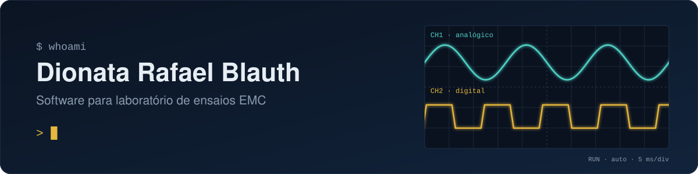
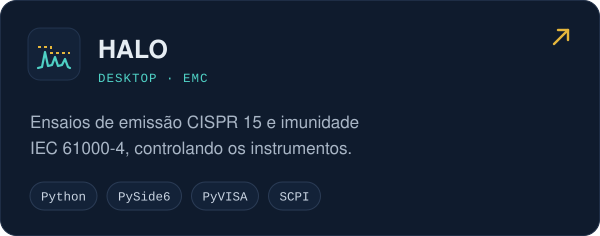
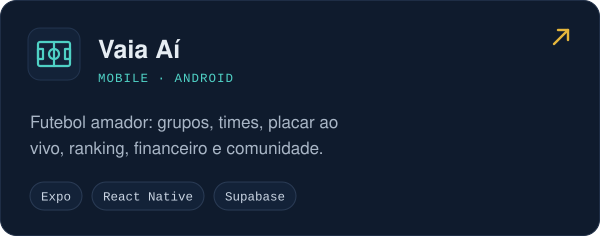
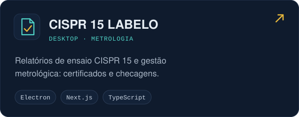
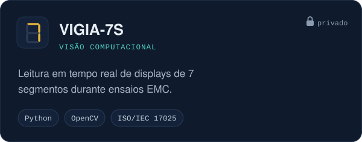

<!-- Este README é montado por scripts/estaticos.py a partir de scripts/README.modelo.md: edite o modelo. -->

  

## Sobre

- Desenvolvo software para laboratório de ensaios de compatibilidade eletromagnética (EMC): automação de
  instrumentos, aquisição de dados e relatórios de ensaio.
- Trabalho com metrologia aplicada: certificados de calibração, incerteza de medição e regras de decisão da
  ISO/IEC 17025.
- Uso visão computacional para automatizar leituras durante os ensaios.
- Também construo aplicativos mobile e web.

## Projetos

  
  
  
  

## Tecnologias

  

## Atividade

  

<picture>
  <source media="(prefers-color-scheme: dark)" srcset="https://raw.githubusercontent.com/rafablauth1/rafablauth1/output/cobrinha-escuro.svg">
  
</picture>
