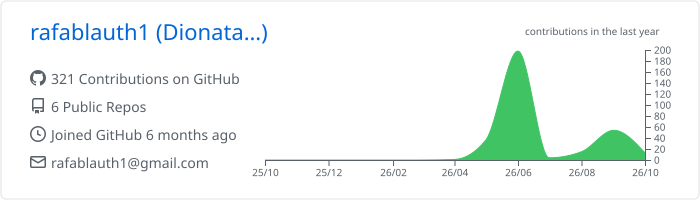
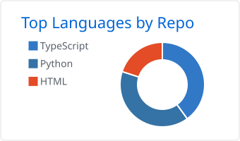
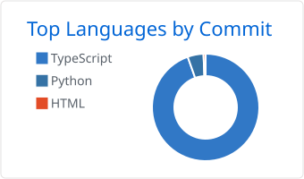
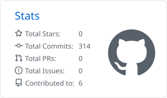
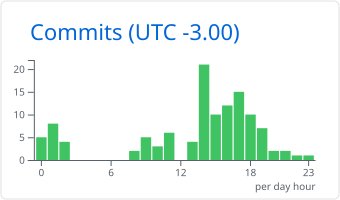

Desenvolvimento de software para laboratório de ensaios de compatibilidade eletromagnética (EMC): automação de
instrumentos, visão computacional, relatórios técnicos e gestão metrológica — além de aplicativos mobile e web.

## Projetos

| Projeto | Descrição | Stack |
|---|---|---|
| [HALO](https://github.com/rafablauth1/Halo) | Ensaios de emissão CISPR 15 e imunidade IEC 61000-4, com controle de receiver R&S e geradores por GPIB | Python · PySide6 · PyVISA |
| [Vaia Aí](https://github.com/rafablauth1/Chega-A-) | App de futebol amador: grupos, times, placar ao vivo, ranking, financeiro e comunidade | Expo · React Native · Supabase |
| [CISPR 15 LABELO](https://github.com/rafablauth1/CISPR-15_) | Gestão de ensaios EMC e do controle metrológico do laboratório | Electron · Next.js · TypeScript |
| [Prime Decor](https://github.com/rafablauth1/Prime_Decor) | Página de links e catálogo de temas de uma loja de decoração de festas | HTML · CSS |

## Áreas de atuação

- Automação de ensaios EMC (CISPR 15, IEC 61000-4-x) e controle de instrumentos por GPIB/SCPI
- Metrologia: certificados de calibração, incerteza de medição e regras de decisão da ISO/IEC 17025
- Visão computacional aplicada a ensaios (leitura de displays de 7 segmentos em tempo real)
- Aplicações desktop (PySide6, Tkinter, Electron), mobile (React Native) e web (Next.js)

## Tecnologias

## Estatísticas

<picture>
  <source media="(prefers-color-scheme: dark)" srcset="profile-summary-card-output/github_dark/0-profile-details.svg">
  
</picture>

<picture>
  <source media="(prefers-color-scheme: dark)" srcset="profile-summary-card-output/github_dark/1-repos-per-language.svg">
  
</picture>
<picture>
  <source media="(prefers-color-scheme: dark)" srcset="profile-summary-card-output/github_dark/2-most-commit-language.svg">
  
</picture>

<picture>
  <source media="(prefers-color-scheme: dark)" srcset="profile-summary-card-output/github_dark/3-stats.svg">
  
</picture>
<picture>
  <source media="(prefers-color-scheme: dark)" srcset="profile-summary-card-output/github_dark/4-productive-time.svg">
  
</picture>

<picture>
  <source media="(prefers-color-scheme: dark)" srcset="https://raw.githubusercontent.com/rafablauth1/rafablauth1/output/github-snake-dark.svg">
  
</picture>

